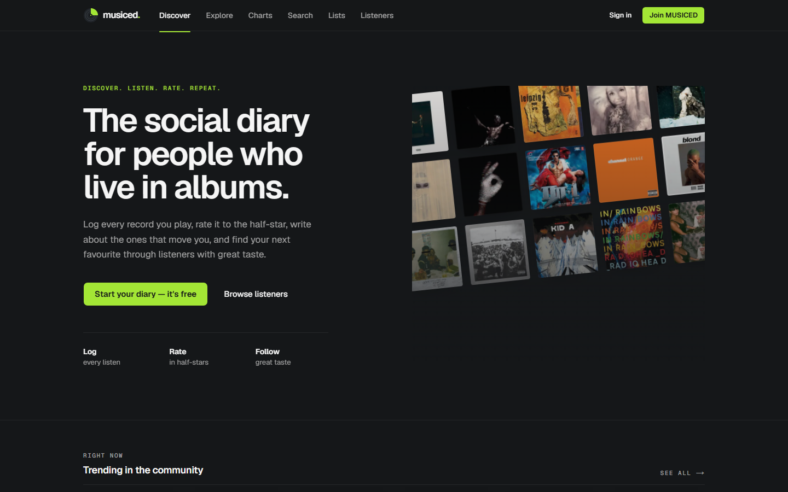
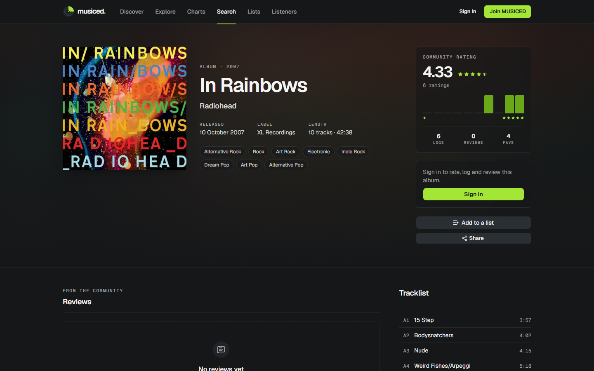
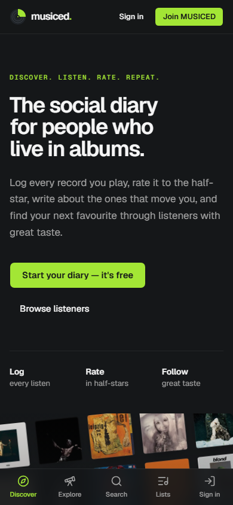
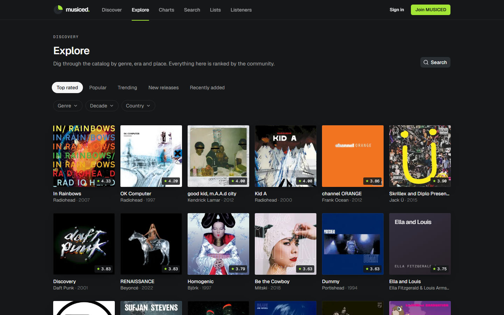

<div align="center">

# musiced.

**The social diary for people who live in albums.**

Log every record you play, rate it to the half-star, write about the ones that move you,
and find your next favourite through listeners with great taste.

[**Live site → musiced.vercel.app**](https://musiced.vercel.app)




</div>

## What it is

MUSICED is a social network for music. Think of it as a listening diary, a ratings site and a feed of
people whose taste you trust, all built around album artwork.

The catalog is real: albums, artists, tracks, genres and cover art come from
[MusicBrainz](https://musicbrainz.org) and the [Cover Art Archive](https://coverartarchive.org).
Any album that isn't in MUSICED yet can be searched for and imported in one click.

## Features

| | |
|---|---|
| **Diary & ratings** | Half-star ratings, a dated listening diary with notes, re-listens and per-entry privacy (public, followers, private) |
| **Reviews** | Spoiler blur, likes, threaded comments, @mentions and sharing |
| **Lists** | Ranked or unranked, drag-and-drop ordering, notes per album, custom covers |
| **Albums & artists** | Artwork, tracklists, credits, rating histograms, related albums, full artist discographies |
| **Discovery** | Personal feed, taste-based recommendations, trending, new releases, Bayesian-ranked charts, Explore by genre, decade, year and country |
| **Social** | Follow and block, profiles with a top-four showcase and listening chart, live notifications |
| **Onboarding** | Six steps: profile, photo, favourite genres, favourite artists, rate a few albums, follow people with similar taste |
| **Moderation** | Reports on reviews, comments and profiles; a staff console to hide, restore, delete or suspend, with an audit log |

<table>
  <tr>
    <td width="72%"></td>
    <td width="28%"></td>
  </tr>
  <tr>
    <td colspan="2"></td>
  </tr>
</table>

## Tech stack

- **App:** Next.js 16 App Router with Cache Components and partial prerendering, React 19, TypeScript (strict)
- **UI:** Tailwind CSS v4, shadcn/ui (Radix), Lucide icons, Motion, dnd-kit, Recharts
- **Data:** Supabase (Postgres 17, Auth, Storage, Realtime) via `@supabase/ssr`
- **Forms:** React Hook Form + Zod, with the same schemas on client and server
- **Testing:** Vitest (unit + database security tests) and Playwright (browser journeys + responsive checks)
- **Hosting:** Vercel, with server functions pinned to the same region as the database

## How it's built

- **The database enforces privacy.** Every table has row-level security and explicit column-level grants,
  so a client can't forge counters, change roles or read someone's private diary, even with the API key.
- **Triggers own derived data.** Album stats, follower counts, activity feed entries and notifications
  (respecting preferences and blocks) are maintained in Postgres, which keeps the app code thin.
- **Pages stream.** A prerendered shell arrives instantly and data streams in; public catalog reads are cached.
- **Catalog import is idempotent.** A provider layer talks to MusicBrainz at its required 1 request per second
  and imports albums in a single transaction keyed by MusicBrainz ID, so nothing is duplicated.
- **Abuse protection.** Postgres-backed rate limits on sign-up, login, password reset, uploads, follows,
  comments, reports and imports, plus a strict set of security headers.

More detail in [docs/ARCHITECTURE.md](docs/ARCHITECTURE.md).

```
src/
├── app/              routes (pages compose; no data logic here)
├── features/         one folder per domain: queries.ts, actions.ts, components/
├── components/       shared UI, layout and design-system pieces
└── lib/              Supabase clients, auth, rate limits, music providers, validation
```

## Running it locally

> **Note:** the Supabase project files (database migrations, seed data and local config) are kept
> out of this public repository, so a fresh clone can't create the database on its own.

With your own Supabase project and schema:

```bash
npm install
# create .env.local with the variables below
npm run dev                    # http://localhost:3000
```

| Variable | Scope | Purpose |
| --- | --- | --- |
| `NEXT_PUBLIC_SITE_URL` | public | Canonical URL for auth redirects and metadata |
| `NEXT_PUBLIC_SUPABASE_URL` | public | Supabase project URL |
| `NEXT_PUBLIC_SUPABASE_PUBLISHABLE_KEY` | public | Supabase publishable key |
| `SUPABASE_SECRET_KEY` | **server only** | Catalog import and rate limiting |
| `MUSICBRAINZ_USER_AGENT` | server | Required by MusicBrainz: `App/Version ( contact )` |
| `NEXT_PUBLIC_AUTH_GOOGLE_ENABLED` | public | `true` to show Google sign-in |

| Command | What it does |
| --- | --- |
| `npm run dev` · `build` · `start` | Next.js |
| `npm run lint` · `npm run typecheck` | ESLint · TypeScript |
| `npm test` | Unit and integration tests |
| `npm run test:e2e` | Playwright browser journeys |
| `npm run catalog:warm -- <site-url>` | Fill a deployed catalog with about 50 well-known albums |

Deployment steps are in [docs/DEPLOYMENT.md](docs/DEPLOYMENT.md).

## Roadmap

- [ ] Google sign-in in production
- [ ] Custom email sender, with email confirmation back on
- [ ] More recent releases in the catalog
- [ ] Premium tier with payments

## Credits

Built by [@arjun2004](https://github.com/arjun2004).

Music metadata © MusicBrainz contributors, released under CC0. Cover art via the Cover Art Archive;
artwork remains the property of its respective owners.
